# DECK//OS

Cyberdeck firmware for the **M5Stack Tab5** (ESP32-P4, 5" 1280x720) with the
official **Tab5 Keyboard**. A touch-first, keyboard-friendly launcher with a
cyberpunk HUD, hosting modules for SSH and Ollama chat, markdown notes, a calculator,
weather, a music player and a file manager with a LAN portal.

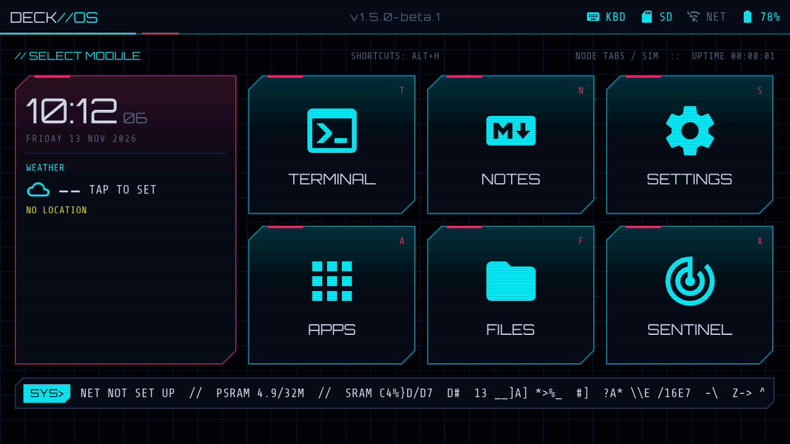

| Boot POST | Settings | Scheduled module |
|---|---|---|
| 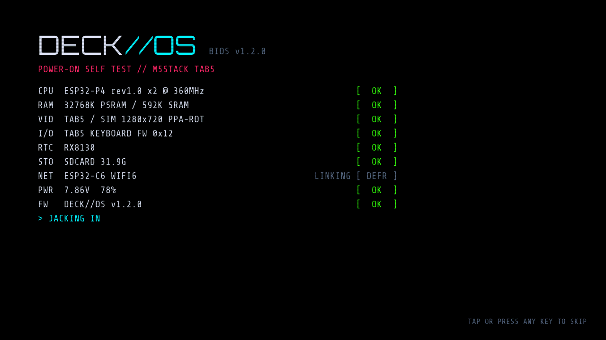 | 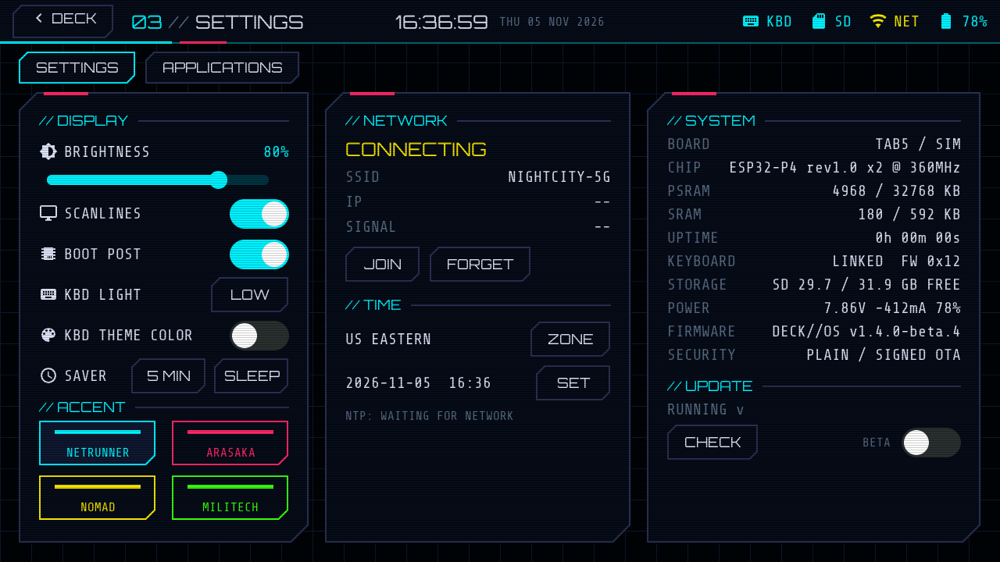 | 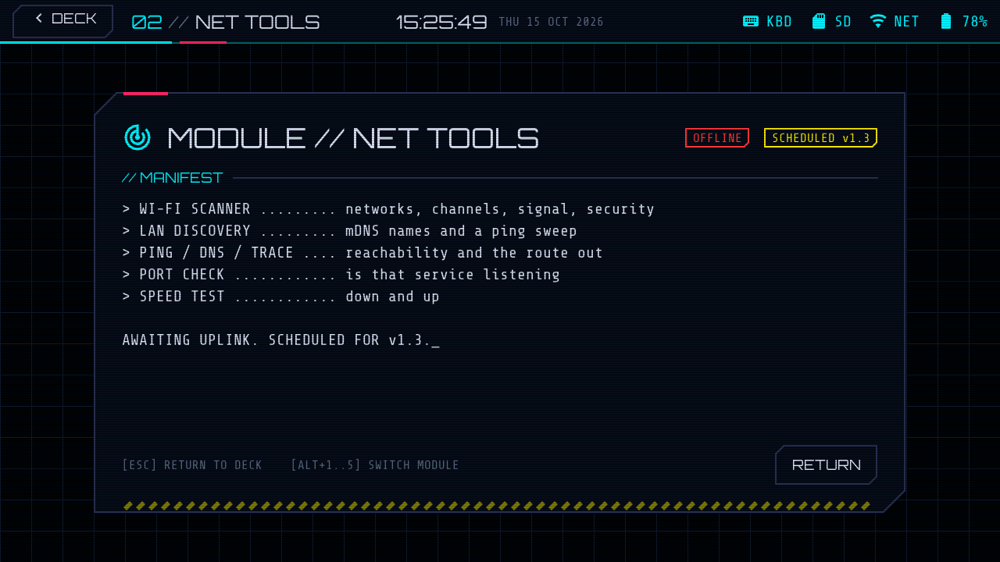 |

## Status: v1.3.0

Seven modules: TERMINAL (SSH and Ollama chat), NOTES (markdown), CALC, WEATHER, PLAYER
(music), FILES (file manager and LAN portal) and SYSTEM. It updates itself over
Wi-Fi with signed builds and tells you when a new one is out.

**Next (v1.5): app toggles and a cleaner home.** The home screen is a live
panel plus six fixed tiles: TERMINAL, NOTES, SETTINGS, CALC, FILES and APPS.
Tiles carry only an icon, a name and their `Alt+letter`. The panel shows live
sections from apps that have one (WEATHER today; tap a section to open the
app). APPS holds the optional apps (WEATHER, PLAYER, NET TOOLS, RF WATCH),
each in a fixed slot. SETTINGS (formerly SYSTEM) has an **APPLICATIONS** tab
with a switch per optional app: a switched-off app is greyed in APPS, does no
background work and ignores its shortcut; tapping its tile opens the switch.
The first greyed tile carries a quiet "enable in settings" hint. The live panel
opens with a big clock and the date (tap it to sleep the screen); on the home
screen the status bar shows the version in the middle instead. SETTINGS >
STYLE > HOME TILES picks how the home deck is painted: GLOW (an accent tint
rising from each tile), TWO-TONE (raised tiles with secondary-neon edges) or
NEON (each home tile in its own color).

| Home | APPS | SETTINGS > APPLICATIONS |
|---|---|---|
|  | 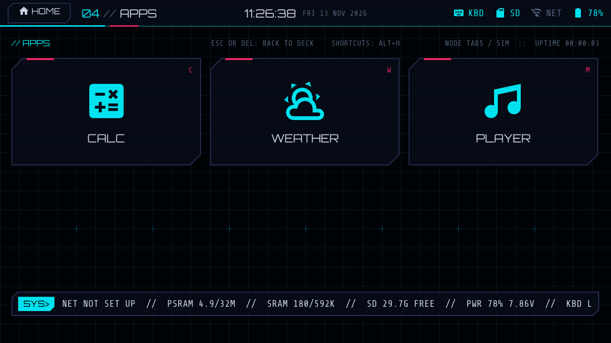 | 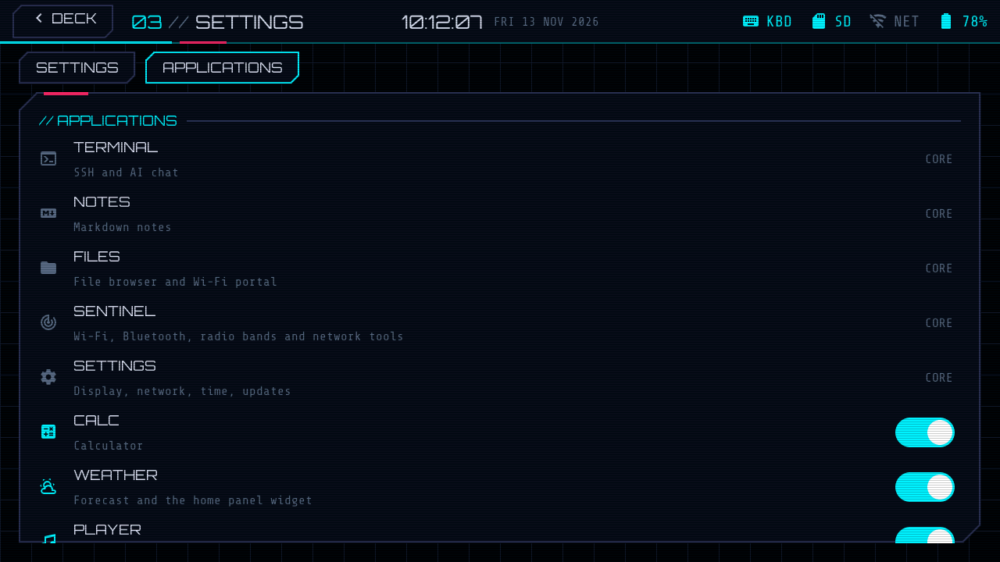 |

**v1.5: RF WATCH**, a safeguarding suite on the RF Sentinel carrier board
on the rear M5-Bus (a Stamp C5 with a CC1101, an nRF24L01+ and a GPS;
`hardware/tab5-board` in the rf-sentinel repo). It watches, detects and
logs; it never jams; and tests that transmit, when they arrive, are aimed
at one chosen target on equipment you own or have the owner's full
permission and knowledge to test.

Opening RF WATCH asks one question first: **SAFE** or **RED TEAM**. SAFE
cannot transmit. RED TEAM also holds the node's arm lease, which the node
checks before any transmit test, and shows RED TEAM in the status bar. The
choice holds until you leave the app; to change it, leave and reopen.
Leaving by any route, switching the app off, the screen sleeping or the
deck restarting all disarm the node: the lease is a dead man's switch that
the deck must keep renewing.

Behind the gate is a chooser of tools. **OVERVIEW** shows the link and board
health, the session, GNSS (fix, satellites, position, C/N0), the networks
the C5 hears, the 433 MHz sweep (21 channels with peak hold), 2.4 GHz
occupancy (126 channels of nRF24 carrier detect) and the newest events;
`H` asks the C5 for HELLO, `P` pings it, `T` knocks on the transmit gate.
**WI-FI** makes the C5 hop all 38 channels (2.4 GHz 1 to 13, 5 GHz 36 to
165) and has four views. MONITOR draws the latest sweep as bars and forty
sweeps of history as a waterfall, red where deauthentication frames were
heard. NETWORKS lists every access point with its channel, security and
whether its management frames are protected, marks an open copy of a
protected name, and says which of channels 1, 6 and 11 has the fewest
neighbours. DRONES lists aircraft broadcasting Remote ID, with the ID and
position they claim. HONEYPOT, in a RED TEAM session only, puts an open
access point with a name you choose on the air, with nothing behind it,
and counts who joins: it is the one thing in RF WATCH that transmits so
far. `C` captures management frames to a pcap file.

**BLUETOOTH** lists every BLE advertiser in earshot, strongest first, and
labels what it recognises: trackers away from their owner (AirTag and other
Find My tags, SmartTag, Tile, Chipolo, Google trackers) in yellow,
surveillance devices (Flock by name, Axon by address prefix) in red. `F`
filters, `M` marks a device as yours so it never alerts, `C` records every
advertisement to a pcap file on the SD card. The scan is passive: the C5
sends nothing. **LOG** shows today's events from storage, newest first, with
where the deck was. TESTS is a placeholder for the last phase in the
rf-sentinel ROADMAP.

**SUB-GHZ** and **2.4 GHZ** are spectrum analyzers for the two bands the
board has radios of its own for. SUB-GHZ > SPECTRUM draws the CC1101's sweep
of 433.0 to 435.0 MHz with peak hold and the last minute or so as a
waterfall, and gives the selected channel's floor, mean, peak and how often
it was busy. SUB-GHZ > BURSTS parks the CC1101 on one frequency (433.92 MHz
unless you tune it) and times every transmission there: how long, how
strong, how long since the last. Bursts of the same shape are grouped into
emitters, and one that keeps a rhythm gets its period ("every 43 s"): that
is how a weather station, a remote or a tyre sensor shows up. It reads
shapes, not contents; nothing is decoded. 2.4 GHZ draws the nRF24's view of
2400 to 2525 MHz with its last sixty reports (about five minutes), marks where Wi-Fi channels 1,
6 and 11 and the Bluetooth advertising channels sit, and says which of the
three Wi-Fi channels carries the least energy. In both, `S` runs a site
survey: it asks what the place is called (Enter alone for no name), then
measures a minute of both bands and writes `sentinel/site-<time>.csv`, or
`site-<time>-kitchen.csv` with a name, with every channel's floor, mean,
peak and busy share. The name is also in the file's first row as you typed
it, so a survey still says where it was taken when you read it later and `B` tells the board that
what it hears now is normal here.

The **jam watch** runs in the background in any app. The board warns once
when half the 433 MHz band rises together, or when 40 or more of the 126
2.4 GHz channels are solid (busy Wi-Fi does not come near that: the most
measured in a flat full of it was 4). The deck then adds what else it
knows: saturation with Bluetooth fallen to a quarter of its usual rate, or
either alarm with the GPS losing satellites or signal, is reported as
likely jamming and names both. RF WATCH detects jamming; it never does it.

**WARDRIVE** writes down what the deck hears and where. `Enter` starts a
drive and `Enter` again, or leaving the screen, ends it. The C5 hops every
Wi-Fi channel with its Bluetooth scan beside it, listening only (no probe
requests, so it works in a SAFE session), and the deck writes two files to
the SD card: `sentinel/wigle-<time>.csv`, access points and Bluetooth
devices with the GPS position in WiGLE's own format (WigleWifi-1.6, ready
to upload to wigle.net), and `sentinel/survey-<time>.csv`, the 433 MHz and
2.4 GHz bands along the same route every five seconds. A row needs a
position and a time and both come from the GPS, so nothing is written
before a fix and the deck's own clock does not matter. A device is written
once per place and again after the deck has moved 25 m. Two things are
never written: networks that opt out of mapping (a name ending `_nomap` or
containing `_optout`) and Bluetooth addresses that rotate (phones, watches,
earbuds). The screen shows each count, and the drive keeps running while
the screen sleeps.

Back from a tool (`Esc`, `Del` or the BACK button in the status bar) returns
to the tools page; back from there leaves RF WATCH and ends the session.

The C5 also watches Wi-Fi all the time, in any app, and warns about four
things: a deauth flood (ten deauthentication frames for one network within
two seconds), an evil twin (a name heard open from one access point and
protected from another; a mesh repeating its name is not one), a beacon
flood (thirty never-heard access points within ten seconds) and karma (one
access point answering for five different names). A drone broadcasting
Remote ID is a warning too. In the background the C5 only passes each
channel briefly every fifteen seconds, so a sustained attack is caught and
a single burst may be missed; with the WI-FI tile open coverage is full.

Tracker and surveillance detection run in the background too, in any app.
A tracker heard for the first time is a line in the log. A tracker that
stays with you is a warning: heard for ten minutes while the deck moved
300 m, or for thirty minutes when there is no GPS fix to tell moving from
sitting still. A label is a match against a published format, not proof,
and a tracker that changes its address starts over as a new device.

While RF WATCH is switched on in SETTINGS > APPLICATIONS the board is
powered (EXT5V on the bus, CC1101 front end in receive: RX_EN on G16 high,
TX_EN on G17 low) and read on UART1 (G7 in, G6 out), whatever is on screen.
The link starts at 115200 and moves to 921600 once the node is known to
speak protocol 2. Every event goes to `sentinel/events-YYYYMMDD.csv` on the
SD card (or internal storage), captured frames to pcap files beside it, and
a wardrive to its two CSV files there.
A warning from the board reaches you in any app: a count in the status bar
until you open RF WATCH, and a banner for a few seconds. Nothing takes the
keyboard and nothing makes a sound. Switching the app off cuts EXT5V.

| Mode gate | Tools (RED TEAM) |
|---|---|
| 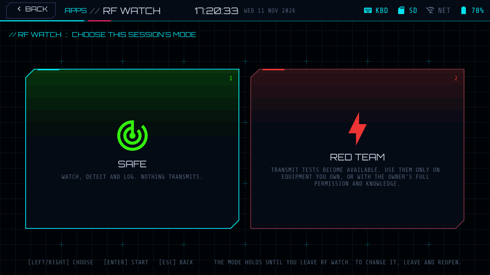 | 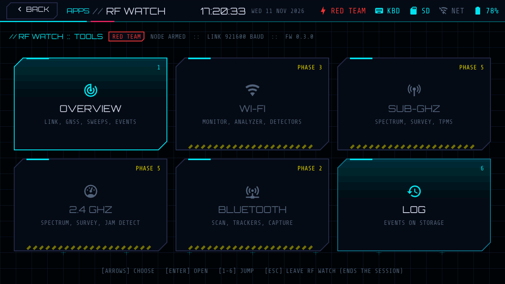 |

| OVERVIEW | A warning while in TERMINAL |
|---|---|
| 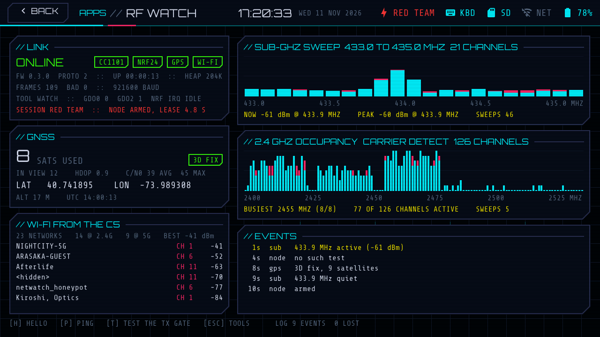 | 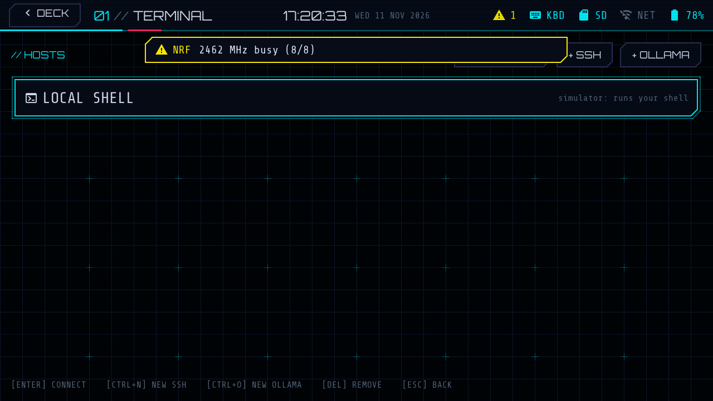 |

| WI-FI monitor | WI-FI networks |
|---|---|
| 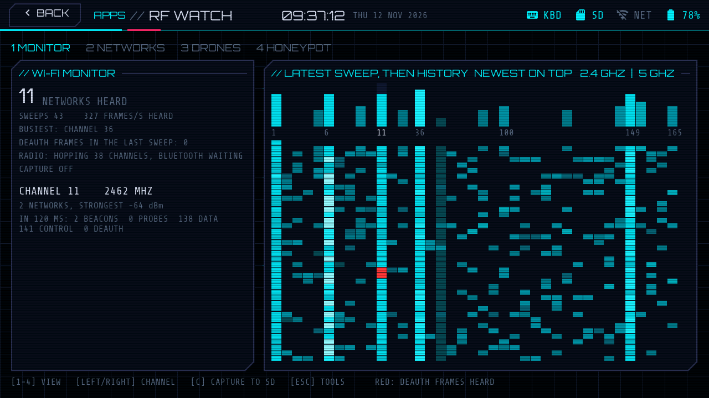 | 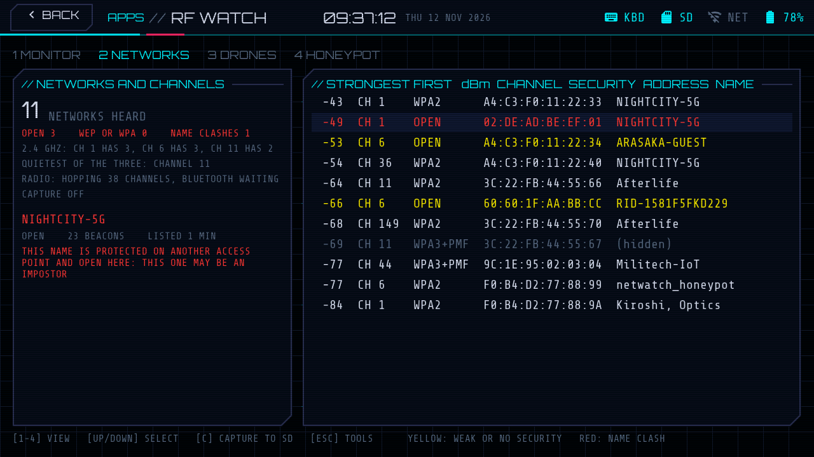 |

| BLUETOOTH | WARDRIVE |
|---|---|
| 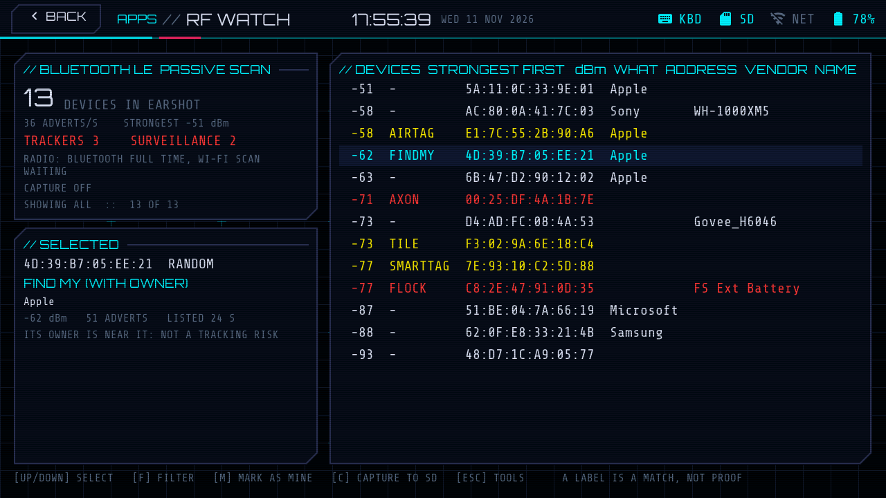 | 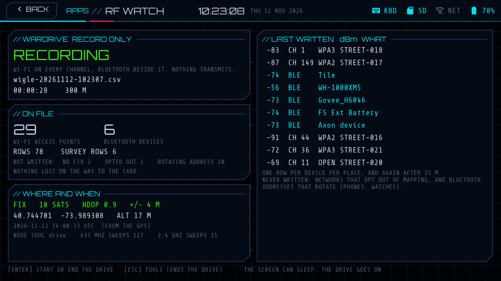 |

| SUB-GHZ spectrum | SUB-GHZ bursts | 2.4 GHZ |
|---|---|---|
| 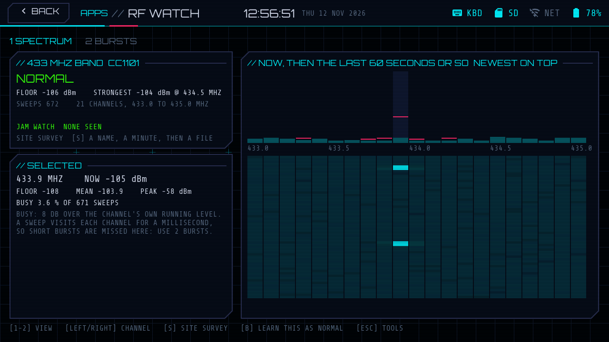 | 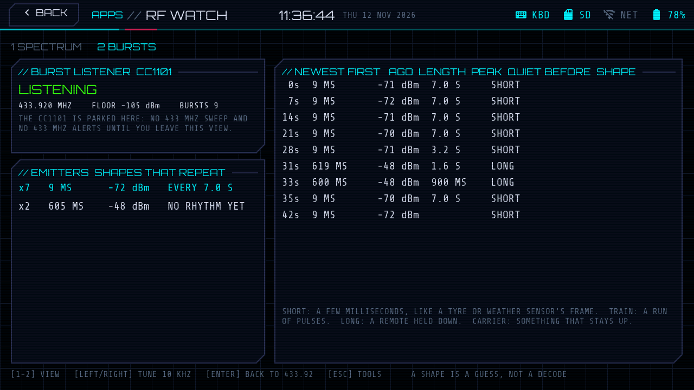 | 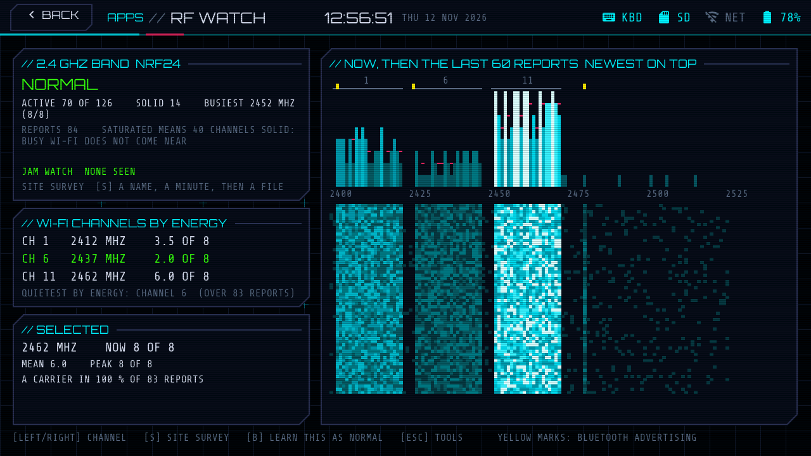 |

The protocol, the state record, the link state machine and the log formats
are `sentinel_core`, a portable library in the rf-sentinel repo that the C5
firmware and the other hosts build too. It comes in as a git submodule at
`external/rf-sentinel` (`git submodule update --init` after cloning).
`components/deck_sentinel` is only the Tab5's side: power, pins, the UART
and the SD files. The simulator has a pretend board (`sim/sentinel_sim.c`)
and the core's tests run with `tools/check.sh`.

**v1.4: NET TOOLS**, the Tab5's own radio as a toolkit (in APPS), next to
RF WATCH. NET TOOLS has four tabs: **SCAN**
(every access point in earshot, one row per BSSID with channel, security and
signal, and a chart of the strongest signal on each 2.4 GHz channel), **PING**
(ping, DNS, traceroute and a TCP port check for a host you type), **LAN** (a
ping sweep of your subnet plus an mDNS browse, with vendors from the MAC
prefix) and **SPEED** (download, upload and connect latency against
speed.cloudflare.com). ICMP runs on a raw socket on the deck and an
unprivileged ICMP socket in the simulator, so the sim exercises the same code.

**v1.3:** the home screen is five tiles instead of one per module.
TOOLS (TERMINAL, CALC, SYSTEM) and FILES & MEDIA (FILES, PLAYER) are groups:
the tile lists what is inside and opens a screen of the same tiles. NET TOOLS
arrives in v1.4 (below). NOTES stays a tile of its own, and WEATHER is a
widget: current temperature, conditions, location and today's range right on
the home screen, tap for the full forecast. (v1.5 replaces the groups with
the fixed home and APPS above.)

**Obsidian vault sync (v1.3):** NOTES has two sources, LOCAL (the deck's
own `/notes`) and VAULT (`/vault`, an Obsidian vault kept in sync with
[Self-hosted LiveSync](https://github.com/vrtmrz/obsidian-livesync) through its
CouchDB). The deck speaks the plugin's database format directly: chunked notes,
end-to-end encryption (PBKDF2 and HKDF, AES-256-GCM) and the same chunk ids,
so what the deck writes dedupes and decrypts like anything the plugin wrote.
NOTES > VAULT > SYNC holds the server, database, login and passphrase, an AUTO
SYNC interval and SYNC NOW with a log. Markdown notes go both ways, with
folders; attachments stay in Obsidian. A note changed on both sides keeps the
Obsidian version at its path and the deck's text beside it as
`name (deck conflict).md`. Supported plugin settings are the defaults: E2EE
"v2" or off, xxhash64 ids, no path obfuscation, no compression; the sync
checks the database's settings first and says what it cannot handle. The
backend sits behind a small interface (`components/deck_sync/deck_sync.h`) so
other sync services can follow.

**v1.2:** screen timeout with a drifting clock screensaver (SYSTEM > SAVER),
Ollama chat in TERMINAL, built on ESP-IDF 5.5, and certificates verified in
software because the ESP32-P4's ECC accelerator rejects GitHub's new
certificate (every build before v1.2.0 lost over-the-air updates and needs
one USB reflash).

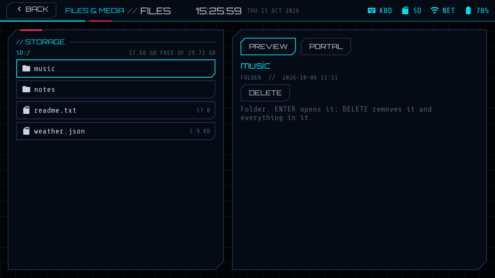

**v1.1:** FILES (module 06, formerly PORTAL) browses the SD card (or internal
storage without one). Select a file to preview it: text as text, markdown
rendered like NOTES, MP3s with a PLAY button that starts PLAYER from that track.
Delete files or whole folders (it asks first, and stops the player if you
delete what is playing). The portal lives on the PORTAL tab, unchanged.
Keys: arrows and `Enter`, `Backspace` up, `Del` or `D` delete, `P` switches
PREVIEW / PORTAL, `Space` engages the portal.

### Ollama chat in TERMINAL

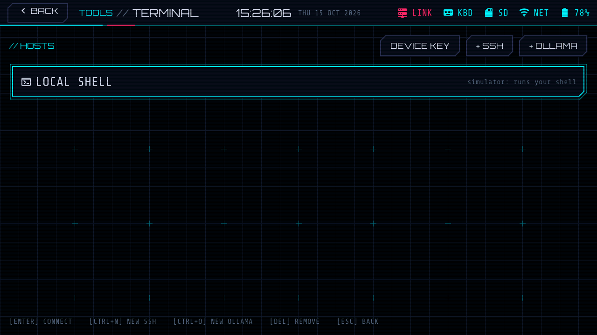

TERMINAL also chats with an [Ollama](https://ollama.com) server on your
network. `+ OLLAMA` (or `Ctrl+O`) in the host list takes `host[:port][/model]`
(port 11434 by default; without a model the server's first chat model is
used), and the entry sits next to your SSH hosts, marked OLLAMA. Replies
stream in as they are generated, a thinking model's reasoning shows dimmed,
and the conversation is kept until `/clear`. `Ctrl+C` stops a reply,
`/models` lists the server's models, `/model NAME` switches, `/bye` or
`Alt+Esc` leaves; the touch bar has STOP, CLEAR, MODELS and HELP.

The server has to listen on the network rather than only localhost: set
`OLLAMA_HOST=0.0.0.0` where Ollama runs. Ollama has no authentication and the
deck talks plain HTTP, so use it on networks you trust.

### v1.0.0

**v1.0:** the deck checks for updates at startup and every hour, and offers a
new build in a popup: INSTALL, IGNORE (skip that version) or LATER. It waits
for a good moment: not while the screen sleeps, in TERMINAL, or during a
portal transfer.

### v0.8.0: music player

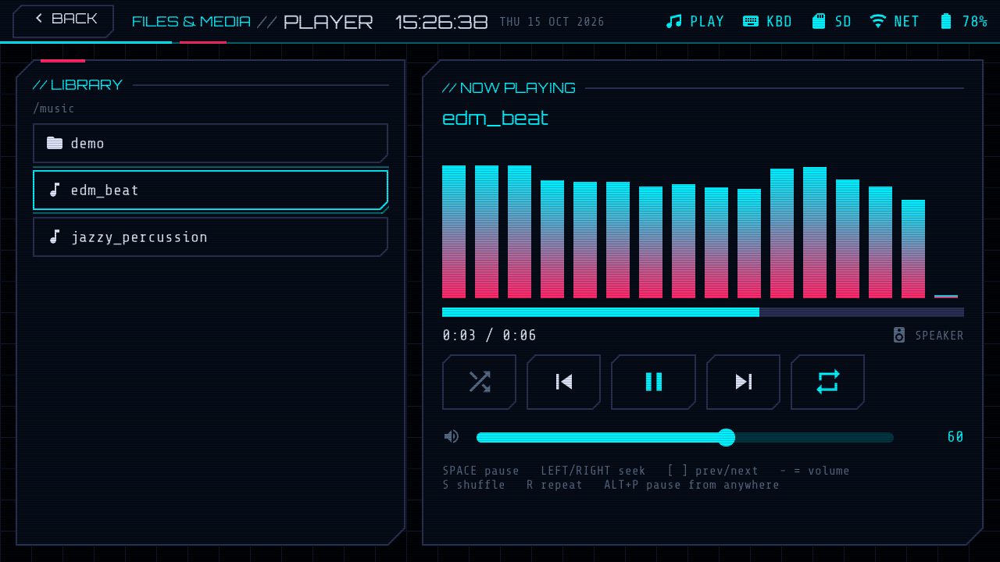

**v0.8:** PLAYER (module 05) plays MP3s from `/music` on the SD card through
the speaker, or the headphone jack when something is plugged in. Browse by
folder, pick a track, and the folder becomes the queue. You get a 16-band
spectrum, ID3 titles, seek (tap the bar or `Left`/`Right`), volume, shuffle and
repeat. Music keeps playing while you use other modules: PLAY in the status bar
(tap it to come back), and `Alt+P` pauses from anywhere. Fill `/music` from your
Mac with FILES > PORTAL.

### v0.7.0: file portal

| On the deck | In your browser |
|---|---|
| 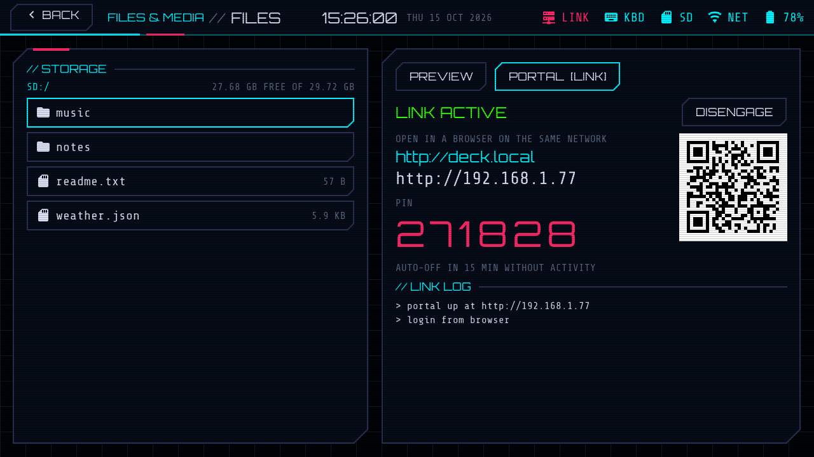 | 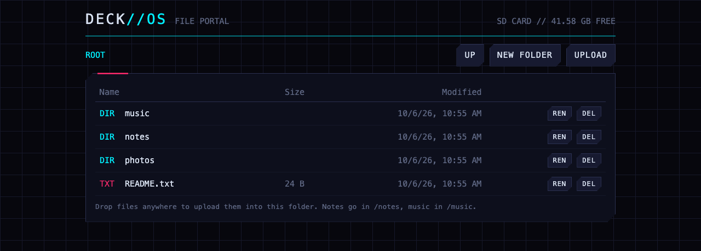 |

**v0.7:** PORTAL (now the PORTAL tab in FILES) shares the deck's storage with any browser on
your network. ENGAGE shows `http://deck.local`, the IP, a QR code for phones
and a one-time 6 digit PIN. From the browser: browse, drag and drop uploads,
download, rename, delete and new folders. `/notes` feeds NOTES and `/music`
is ready for the player. The portal keeps running while you use other
modules (LINK in the status bar), switches itself off after 15 minutes idle,
locks for 30 s after 5 wrong PINs, and never exposes the SSH key folder.
It is plain HTTP on your LAN, so use it on networks you trust.

| PIN screen | Link down |
|---|---|
| 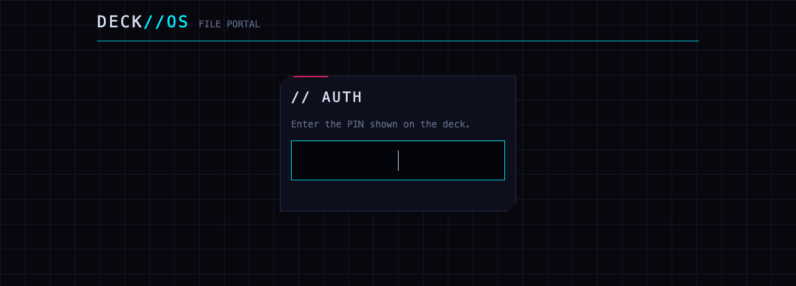 | 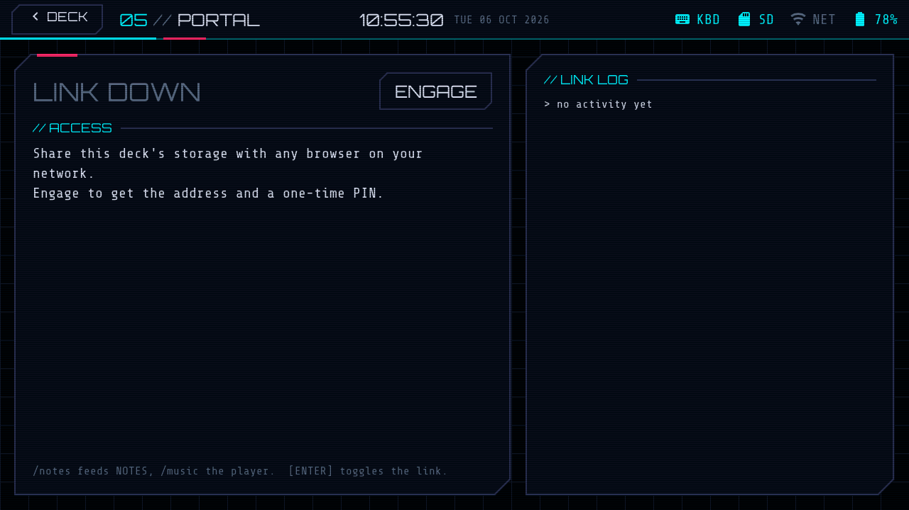 |

**v0.6.1:** SYSTEM > KBD LIGHT (OFF / LOW / HIGH) and KBD THEME COLOR (keyboard
LEDs follow the accent). `Alt+0` or a tap on the clock sleeps the screen.

### v0.6.0: SSH terminal

**v0.6:** TERMINAL is an SSH client with an xterm-compatible screen (256
colors, full-screen apps like htop and vim, 2000 lines of scrollback). Hosts
are saved on the SD card; first connections show the server's fingerprint to
trust, and a changed key gets a loud warning. Log in with a password or the
deck's own ECDSA key (DEVICE KEY shows the public key for authorized_keys).
Every key goes to the remote, Esc included; `Alt+Esc` leaves. The touch bar
adds Esc, Tab, sticky Ctrl, arrows, PgUp/PgDn, Home/End and F1 to F12.
Shift+Up/Down or dragging scrolls back.

### v0.5.0: over-the-air updates

**v0.5:** SYSTEM > UPDATE checks GitHub Releases, installs the new build over
Wi-Fi into the idle app slot, and reboots. A new build must run cleanly for
15 s before it is kept; otherwise the bootloader rolls back to the previous
one. A blinking UPD in the status bar means an update is waiting. The BETA
switch includes pre-releases. Releases from v0.5.0 on carry two images:
`*-full.bin` for USB (written at 0x0) and `*-ota.bin` for over-the-air.

### v0.4.0


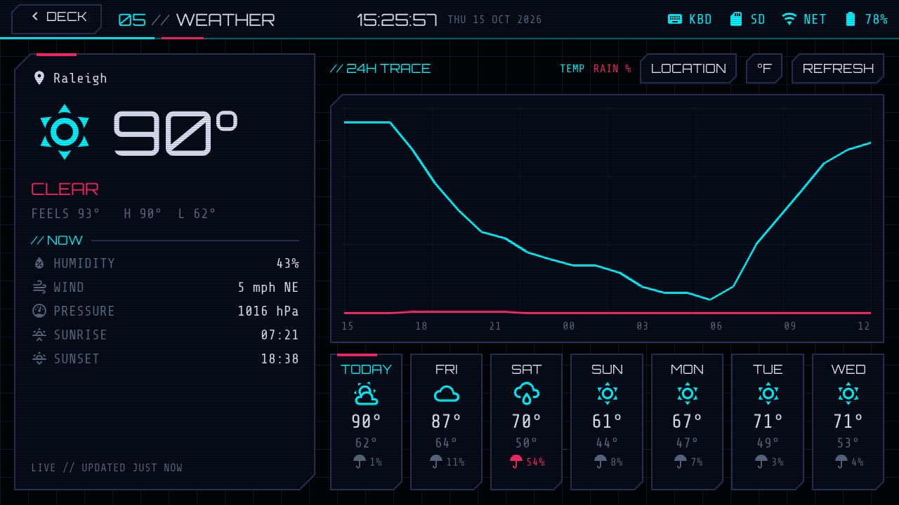

**v0.4:** Wi-Fi through the Tab5's ESP32-C6 (no C6 reflash needed: the
firmware talks to M5Stack's factory ESP-Hosted v1.4.1), network join from
SYSTEM (scan, password, hidden networks, forget), NTP clock sync written back
to the RTC, 17 timezones, and the WEATHER module: Open-Meteo by city search,
current conditions, 24 h temperature and rain trace, 7-day strip, offline
cache. Keys in WEATHER: `R` refresh, `L` location, `U` units.
Parser tests: `cmake --build sim/build --target weather_test && sim/build/weather_test`.
LiveSync hash and crypto ports: `cmake --build sim/build --target ls_test && sim/build/ls_test`
(vectors in `sim/ls_vectors.h` were generated with the plugin's own JavaScript).

### v0.3.0 (released)

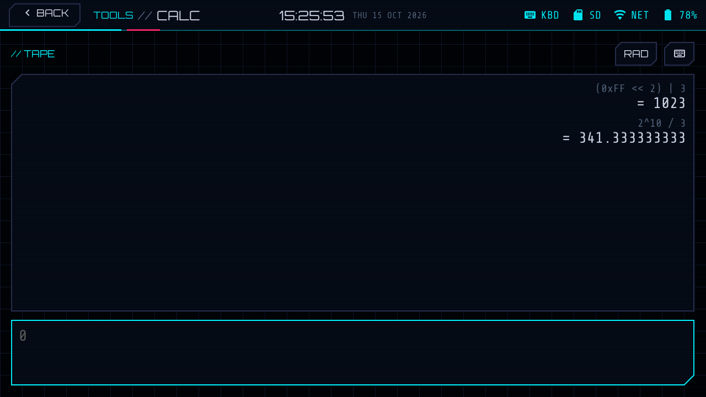

**v0.3:** CALC module with live results as you type, a tape of past
results, hex/oct/bin readout for integers, DEG/RAD, and a touch keypad with
SCI and PROG pages that hides once you type. `Enter` evaluates, `Up/Down`
recall, `Ctrl+D` deg/rad, `Ctrl+K` keypad, `Ctrl+L` clear tape. Engine tests:
`cmake --build sim/build --target calc_test && sim/build/calc_test`.

### v0.2 (merged)

| Notes: split edit + live preview | Notes: preview |
|---|---|
| 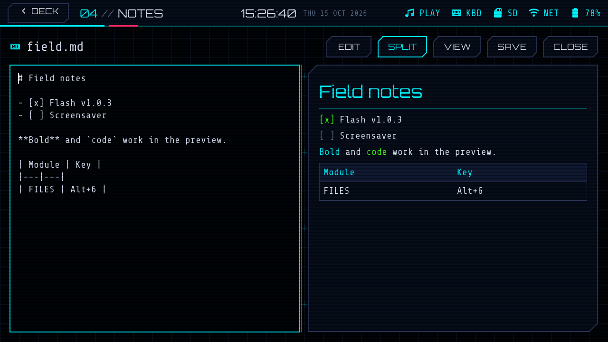 | 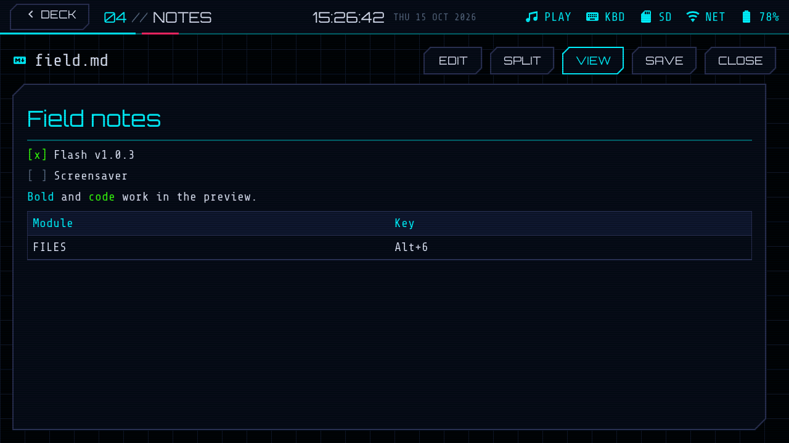 |

**v0.2 so far:** NOTES module with a file browser (new, rename, delete), a
monospace editor, a rendered preview (headings, emphasis, lists, task lists,
quotes, code, tables, rules) and a live split view. Files are plain `.md` in
`/sdcard/notes`, or in internal flash when no card is inserted. `Ctrl+S` save,
`Ctrl+P` edit/preview, `Ctrl+T` split, `Esc` save and close, autosave after
20 s. Partition table is now OTA-ready (see ROADMAP v0.8), which means one USB
flash when moving from v0.1.

### v0.1.0 (released)

- Boot POST that reports real hardware state (keyboard, SD, RTC, battery); tap or any key skips it
- HUD status bar: clock, keyboard link, SD, network, battery
- Launcher: a live panel and six large touch tiles, optional apps under APPS, keyboard navigation and a live system ticker
- Glitch transitions, optional CRT scanlines, four accent themes (NETRUNNER, ARASAKA, NOMAD, MILITECH)
- **SETTINGS** module: an APPLICATIONS tab to switch optional apps on and off; brightness, scanlines, boot sequence, accent, RTC clock setting, live hardware readout
- TERMINAL is a placeholder until v0.7 that show their planned features until their version lands

See [ROADMAP.md](ROADMAP.md) for v0.2 onward.

## Controls

| Keys | Action |
|---|---|
| `Alt+1..6` | Open home tile 01..06 |
| `Alt+A` | Open APPS |
| `Alt+T` `N` `S` `C` `F` | Jump to TERMINAL, NOTES, SETTINGS, CALC or FILES from anywhere |
| `Alt+W` `M` `R` `X` | Jump to WEATHER, PLAYER (music), NET TOOLS or RF WATCH, while switched on |
| `Alt+Esc` | Return to the deck from anywhere (reserved for when SSH owns `Esc`) |
| `Alt+0`, tap the clock, or SETTINGS > SAVER > SLEEP | Sleep the screen (backlight and keyboard light off); any key or touch wakes it |
| (idle) | After SETTINGS > SAVER minutes (default 5) a drifting clock takes over, dimmed; 10 minutes later the screen sleeps. Any key or touch wakes it |
| `Alt+H`, or tap the hint on the home screen | List every shortcut |
| `Alt+P` | Pause or resume music from anywhere (while PLAYER is on) |
| `Esc` or `Del` | Back / close, or up one level (an app to APPS, APPS to the deck) if the module does not use it. `Del` still deletes inside a text field, and deletes the selected item in NOTES, FILES and TERMINAL |
| Arrows, `Enter`, or `1..6` | Pick a tile on the home screen or in APPS |
| `Tab`, arrows | Move focus inside a module |

Everything is also reachable by touch: tiles, panel sections, the `< DECK` back button and on-screen controls.

## Install from the browser

[**hey-its-brian.github.io/tab5-cyberdeck**](https://hey-its-brian.github.io/tab5-cyberdeck/): plug the
Tab5 in over USB-C, click INSTALL in Chrome or Edge. After that, updates come
over Wi-Fi (SETTINGS > UPDATE).

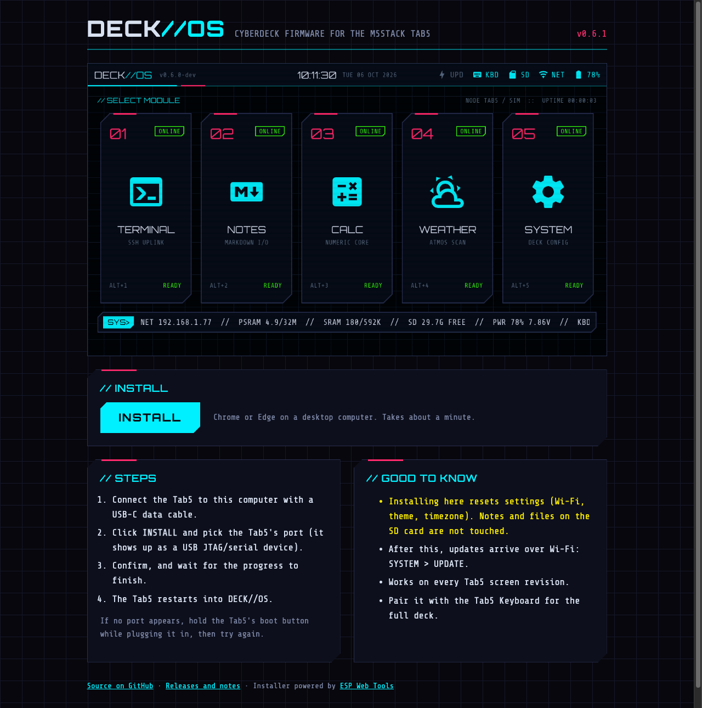

## Security

- **Settings are encrypted** (Wi-Fi password, SSH device key, everything in
  NVS). On its first boot, v0.7.1 or later generates a random key, burns it into
  one free eFuse key block, and moves the existing settings over. This is the
  only eFuse change. It does not restrict flashing, and if anything goes wrong the deck
  falls back to plain settings rather than failing to boot. SETTINGS > SECURITY
  shows which mode is active.
- **Updates are signed.** A deck running a signed build only installs
  over-the-air updates signed with the same key (RSA-3072). Nothing is
  burned for this, and the bootloader does not check signatures, so USB and the web
  flasher can always write any image. A board can't be locked out.
- **The SSH device key** lives in encrypted settings, not on the SD card. A key
  left on the card by v0.6 to v0.7.0 is moved in (same key, so `authorized_keys`
  still matches) and the file is wiped. `known_hosts` stays on the card.
- The file portal is plain HTTP with a one-time PIN. Use it on networks you trust.
- No Secure Boot or flash encryption: both are one-way and could lock a board
  to one signing key.

## Releasing

`tools/release.sh X.Y.Z notes.md "Title"` from a clean `main`: bumps the version,
builds, signs the app, attaches the full (USB/web) and OTA images to a GitHub
release, and the release deploys the web flasher. Betas: `tools/release.sh
X.Y.Z-beta.N notes.md "Title" --prerelease` from any branch (betas skip the web
flasher). The signing key is read from `~/.config/deck-os/ota_signing_key.pem`
(or `DECK_SIGNING_KEY`). Keep it backed up and out of the repo: without it,
signed decks can only be updated over USB.

## Build and flash

Needs ESP-IDF 5.4 or newer.

```bash
. ~/esp/esp-idf/export.sh
```

```bash
idf.py set-target esp32p4
```

```bash
idf.py build
```

```bash
idf.py -p /dev/cu.usbmodem* flash monitor
```

The panel revision (ILI9881C, ST7123 or ST7121) is detected at runtime, so
one image works on every Tab5.

Builds from source are unsigned: the signed-update settings live in
`sdkconfig.release`, which only `tools/release.sh` applies, so a fresh clone
builds and boots without a signing key. An unsigned build installs the official
over-the-air updates too (only signed builds check signatures). Note that, like
the official firmware, any build burns its settings encryption key into a free
eFuse key block on first boot (see Security).

## Desktop simulator

`sim/` runs the same UI code (everything above `deck_hal` and `deck_net`) on
SDL2 with fake hardware and a pretend radio (HTTP goes through `curl`, so
WEATHER shows live data; pass `--wifi` to start "connected"), so screens can be developed and checked without the board. It
reuses the LVGL tree that `idf.py build` downloads (or fetches LVGL 9.5.0 if
that is missing). Needs `brew install sdl2 cmake`.

```bash
cmake -S sim -B sim/build && cmake --build sim/build -j
```

```bash
./sim/build/deck_sim
```

Mouse is touch; the Mac keyboard acts as the Tab5 Keyboard (Option is Alt).
Headless mode renders scripted screenshots on a virtual clock:

```bash
./sim/build/deck_sim --headless --no-boot --key 500:alt+s --shot 1500:system.ppm
```

`--key MS:SPEC` (e.g. `esc`, `enter`, `left`, `a`, `alt+2`, `ctrl+s`), `--tap MS:X,Y` and
`--shot MS:FILE.ppm` can repeat; `--set KEY=VALUE` seeds a setting (for example
`--set wx_name=Raleigh --set wx_lat=35.78 --set wx_lon=-78.64` gives the WEATHER
widget a location), `--stub-apps N` adds placeholder optional apps to check
the APPS grid, and `--realtime` runs on the wall clock (for real network
fetches). Convert with `sips -s format png in.ppm --out out.png`.

Every check that needs no hardware runs in one command, printing one line per
stage and PASS or FAIL (full output in `sim/build/check.log`):

```bash
tools/check.sh             # simulator build and host unit tests
tools/check.sh --firmware  # also builds the ESP-IDF firmware
```

GitHub Actions runs `tools/check.sh --firmware` on every push and pull request
(`.github/workflows/check.yml`, in Espressif's ESP-IDF v5.5.5 image).

The portal's browser side runs on the Mac too: `tools/portal_mock.py` serves
the real page backed by `sim/sdcard` at `http://127.0.0.1:8080` (PIN `271828`,
`--open` skips it, `--root DIR` picks another folder).

## Layout

```
main/                 app_main: hal_init, theme, input, register modules, start shell
components/
  deck_hal/           the only hardware-aware layer (C API); hal_tab5.cpp for the board
  deck_ui/            theme tokens + fonts, chamfered panel widgets, effects
  deck_core/          app registry, key routing, shell, status bar, launcher, boot POST, modals
  deck_md/            markdown to LVGL renderer (md4c)
  deck_net/           Wi-Fi over the ESP32-C6 (ESP-Hosted), SNTP, HTTPS fetch
  deck_portal/        LAN file portal: HTTP server, JSON API, PIN login, mDNS, web page (www/)
  deck_audio/         music player: minimp3 decode task, queue, ID3, ES8388 output (aout_tab5.c)
  minimp3/            minimp3 MP3 decoder (vendored, CC0)
  md4c/               md4c markdown parser (vendored, MIT)
  m5_tab5_component/  M5Stack Tab5 BSP (vendored, MIT)
  m5_tab5_keyboard_component/  M5Stack Tab5 Keyboard driver (vendored, MIT)
apps/                 one component per module (app_sys is the template for real ones)
assets/fonts/         Orbitron, Share Tech Mono, MDI icon subset (tools/subset_icons.sh)
sim/                  SDL2 desktop simulator and fake HAL
```

### Writing a module

A module is a `deck_app_t` with `on_start(parent)` and optional `on_key`,
`on_exit` (save work; widgets still alive) and `on_stop` callbacks (see `components/deck_core/include/deck_app.h`). Build the
UI under `parent` with the `deck_ui` kit, register it in `main/main.c` and in
`sim/main.c`, and add its folder to `main/CMakeLists.txt`.

### Design notes

- **Keyboard path.** The Tab5 Keyboard runs in HID mode over I2C (0x6D on G0/G1)
  and reports releases as code 0. `deck_input` turns events into shell hotkeys,
  then the module's `on_key`, then LVGL keypad keys. It is polled every 10 ms
  rather than using the INT pin, which is edge triggered and can strand an event.
  The keyboard is hot-pluggable.
- **Display.** Direct mode (only dirty areas redraw), frame buffer in PSRAM,
  landscape via PPA rotation. Effects are sized for that: the grid and
  scanlines draw only inside the area being refreshed.
- **Fonts** are TTFs rendered at runtime by LVGL's tiny_ttf. Icons sit in their
  own labels (`deck_icon_text`) instead of being a font fallback, because each
  fallback lookup logs an error.

## Credits

See [THIRD_PARTY.md](THIRD_PARTY.md).
